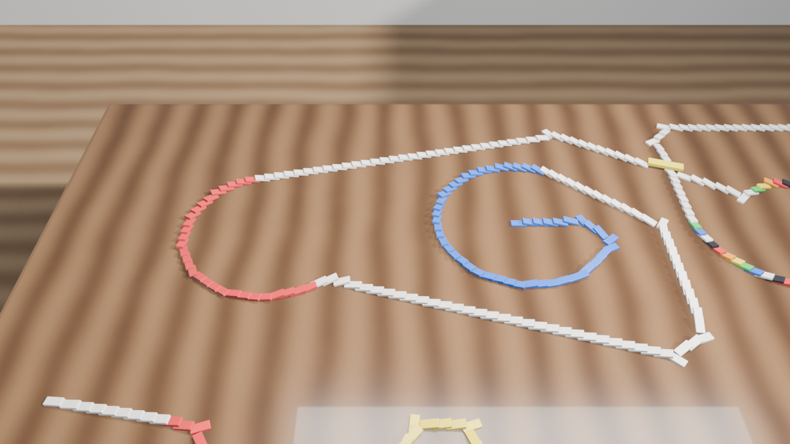

# Domino Chain Reaction Animation



A college Computer Graphics project made in **Blender** (works on 4.x and
5.x). ~450 colourful dominoes topple across a large polished wooden table —
through curves, an S-path, a zig-zag, a circle, up a staircase, over a
bridge, releasing a rolling **marble**, firing a **seesaw**, through a
**spiral** — and finally fall to reveal the letters **"CG"**.

The whole scene is generated and simulated by one script, so it is fully
reproducible and easy to tweak.

## Files

| File | What it is |
| --- | --- |
| `generate_domino_scene.py` | Self-contained generator: builds the room, table, dominoes, mechanisms, physics, lights and camera, bakes the rigid-body simulation, and times the camera to the baked sim. |
| `domino_chain_reaction.blend` | The generated scene with the simulation **already baked** — open and press Play, or render straight away. |
| `renders/` | A few preview stills from the final scene. |
| `domino_chain_reaction.mp4` | The rendered animation (1080p, Eevee, about 59 seconds). |
| `PROJECT_GUIDE.md` | Beginner-friendly explanation of how the scene and physics work. |

## Open and render the .blend

1. Open `domino_chain_reaction.blend` in Blender.
2. Press **Spacebar** to play the baked animation in the viewport.
3. Render the video with **Render → Render Animation** (Ctrl+F12). Output
   goes to `render/domino_chain_####.mp4` next to the .blend (H.264,
   1920×1080, 24 fps).

Cycles on CPU is slow; for a quick draft switch Render Properties → Render
Engine to **Eevee**.

## Regenerate from scratch

```
blender --background --python generate_domino_scene.py
```

or open the script in Blender's Text Editor and press **Run Script**.
Building + baking takes a few minutes. The script prints when each section
of the chain triggers and verifies every domino falls (`CHAIN COMPLETE`).

All tunable numbers (domino size/spacing, table, staircase, marble, seesaw,
animation length, physics quality) live in the `CFG` dict at the top.

## Scene contents

* **Environment** — simple modern room: floor, walls, a window on one side,
  and a large polished walnut table (3.6 m × 2.1 m).
* **Dominoes** — ~450 plastic dominoes (50 × 24 × 8 mm) in seven colours,
  one continuous chain: lead-in → S-curve → zig-zag → circular loop →
  staircase (7 steps) → bridge → marble track → seesaw → spiral → crossover
  → letters **C** (red) and **G** (blue).
* **Mechanisms**
  * *Marble track* — an elevated domino nudges a steel marble down a wooden
    chute; it rolls to table level and knocks the chain onward.
  * *Seesaw* — a domino topples onto the input arm of a hinged plank; the
    rising output tip flicks a payload domino onto the next one.
  * *Crossover* — a double-height domino carries the chain over a lane that
    has already fallen (the spiral's entry corridor).
* **Physics** — Blender rigid bodies (Bullet): box shapes for dominoes,
  convex hulls for the wooden props, a hinge constraint for the seesaw. The
  whole simulation is baked into the .blend. `time_scale = 0.45` gives a
  pleasant slight slow-motion.
* **Lights** — one warm Sun through the window + one large soft area light.
* **Camera** — a single camera, one continuous slow move: wide establishing
  shot → follows the chain → pauses at the marble → follows on → pulls up
  over the letters and holds on the "CG" reveal. Keyed automatically from
  the baked sim.

## Collections

```
Environment   room + table
Dominoes      all domino objects (Domino_0001_lead_in, ...)
Props         stairs, platforms, bridge, chute, marble, seesaw
Lights        Sun_Key, Area_Fill
Camera        Camera_Main, Focus_Target
Physics       Seesaw_Hinge constraint
```

A text datablock `SIM_NOTES` inside the .blend lists each section's trigger
frame in the baked run.

## Render settings

* Blender 4.x / 5.x, Cycles (CPU), 128 adaptive samples + denoising
* 1920×1080, 24 fps, H.264 MP4
* The full run is ~1 minute: the chain reacts, then holds on the "CG"
  reveal for ~12 s.

### Making it longer

The pace is set by `CFG["time_scale"]` (0.45 = the stable value). Lower
values give slower, longer slow-motion, but the dominoes are
start-deactivated rigid bodies, so going much below ~0.4 starves later
collisions of wake impulse and the cascade stalls. To reach a full ~2 min
reliably you'd also lower each domino's deactivation thresholds (or start
them active) in `build_dominoes` — left out here to keep the chain robust,
which the brief asks for over exact length.
